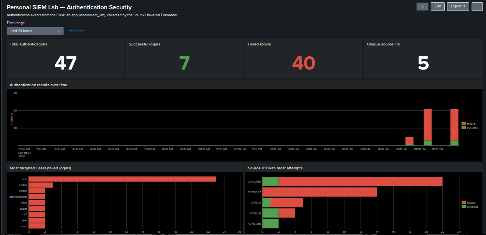
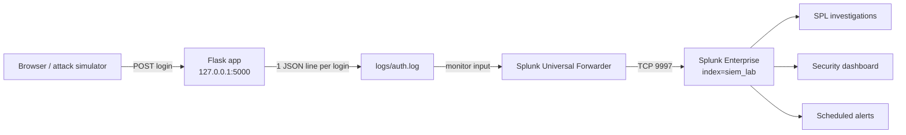
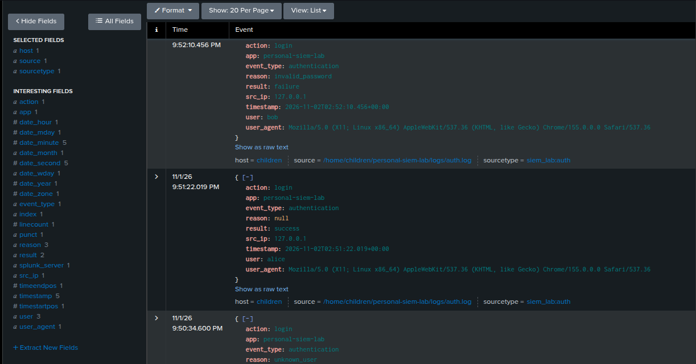
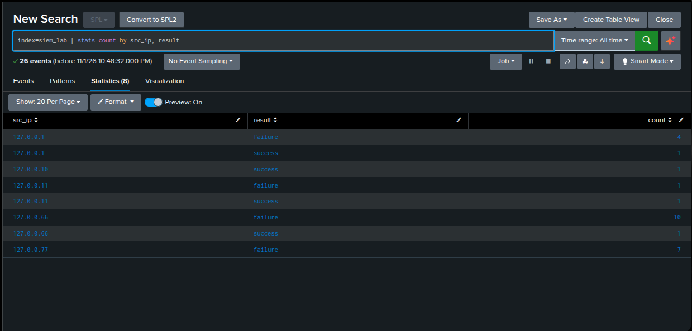
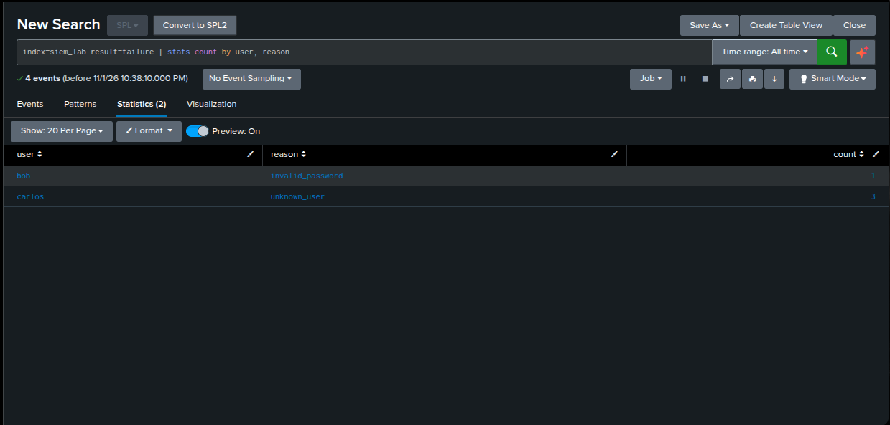
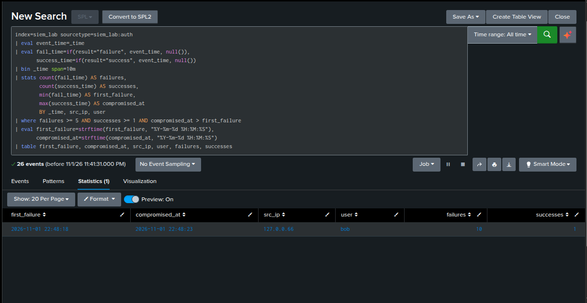
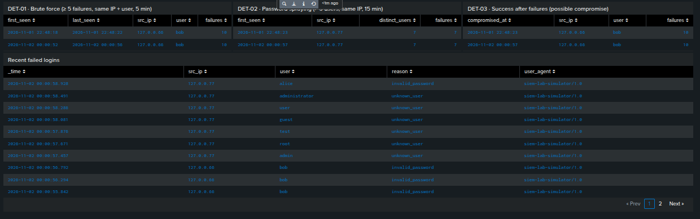
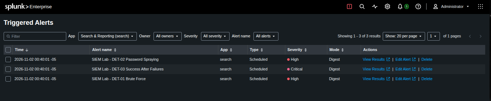

# Personal SIEM Lab

A hands-on detection engineering lab: a Flask web app with authentication generates
structured security logs, the **Splunk Universal Forwarder** ships them to
**Splunk Enterprise**, and **SPL** is used to investigate events, build detections,
a security dashboard and scheduled alerts.

Attacks (brute force and password spraying) are **simulated locally** against the
lab's own app on `127.0.0.1` — no external systems are involved.



---

## Architecture



1. A user (or the simulator) submits the login form.
2. The app checks the password hash and writes one JSON event to `logs/auth.log`.
3. The Universal Forwarder tails the file and forwards each new line to the indexer.
4. Splunk Enterprise parses it with a custom sourcetype and stores it in `index=siem_lab`.
5. Detections run on a schedule and raise alerts; the dashboard summarizes activity.

## Tech stack

| Layer | Technology |
|---|---|
| Web app | Python 3, Flask, Jinja2 |
| Password storage | Werkzeug `generate_password_hash` / `check_password_hash` (scrypt + salt) |
| Logging | Python `logging`, JSON Lines |
| Collection | Splunk Universal Forwarder (`monitor` input) |
| SIEM | Splunk Enterprise (custom index + sourcetype) |
| Query language | SPL |
| Attack simulation | Python standard library (`http.client`) |
| OS / shell | CachyOS (Arch Linux), Fish |

## Repository structure

```text
personal-siem-lab/
├── app/
│   ├── app.py                  # Flask routes and authentication
│   ├── security_logger.py      # Writes authentication events as JSON lines
│   ├── static/style.css
│   └── templates/              # base, login and "access granted" pages
├── scripts/
│   └── simulate_attack.py      # Local attack simulator (normal / bruteforce / spray)
├── detections/                 # Documented detections (logic, SPL, false positives, response)
├── splunk/
│   ├── enterprise/             # indexes.conf, props.conf, savedsearches.conf
│   ├── forwarder/              # inputs.conf
│   └── dashboards/             # Simple XML dashboard
├── screenshots/
├── logs/                       # Generated at runtime (git-ignored)
└── requirements.txt
```

## The security event

Each login attempt produces one JSON line:

```json
{"timestamp": "2026-11-02T03:48:22.999+00:00", "app": "personal-siem-lab", "event_type": "authentication", "action": "login", "result": "failure", "reason": "invalid_password", "user": "bob", "src_ip": "127.0.0.66", "user_agent": "siem-lab-simulator/1.0"}
```

| Field | Why it is logged |
|---|---|
| `timestamp` | UTC with milliseconds — consistent across systems and precise enough to measure attack speed |
| `result` | `success` / `failure` |
| `reason` | `invalid_password` vs `unknown_user` — the UI shows a generic message (prevents user enumeration), but the log keeps the real reason for analysts |
| `user`, `src_ip` | Who was targeted and from where |
| `user_agent` | Separates browsers from scripts |

**Passwords are never logged** — not even wrong ones, which are often a typo of the real password.

## Splunk configuration

**Index** — `siem_lab` keeps lab data isolated ([indexes.conf](splunk/enterprise/indexes.conf)).

**Sourcetype** — `siem_lab:auth` ([props.conf](splunk/enterprise/props.conf)): one event per line,
explicit timestamp extraction (`TIME_PREFIX` / `TIME_FORMAT`) and JSON field extraction (`KV_MODE = json`).

**Forwarder input** ([inputs.conf](splunk/forwarder/inputs.conf)):

```ini
[monitor:///home/children/personal-siem-lab/logs/auth.log]
index = siem_lab
sourcetype = siem_lab:auth
```



## Attack simulation

`scripts/simulate_attack.py` sends login requests to the local app only. Each scenario
binds to a different loopback address (`127.x.x.x`), so Splunk sees distinct source IPs
without trusting spoofable headers like `X-Forwarded-For`.

| Scenario | Source IP | Behavior | Technique |
|---|---|---|---|
| `normal` | `127.0.0.10/.11` | Valid logins and one typo | Baseline noise |
| `bruteforce` | `127.0.0.66` | 11 passwords against `bob`; the last one is correct | T1110.001 → T1078 |
| `spray` | `127.0.0.77` | Password `123456` against 7 usernames | T1110.003 |

The simulator identifies itself as `siem-lab-simulator/1.0`, so simulated traffic is
always distinguishable from manual testing.

## Investigation with SPL

| Question | SPL |
|---|---|
| Success vs. failure | `index=siem_lab \| stats count by result` |
| Most targeted users | `index=siem_lab result=failure \| stats count by user \| sort -count` |
| Why did logins fail? | `index=siem_lab result=failure \| stats count by user, reason` |
| Attempts per source IP | `index=siem_lab \| stats count by src_ip, result` |
| Browser vs. script | `index=siem_lab \| stats count by user_agent` |
| Accounts tried per IP | `index=siem_lab result=failure \| stats dc(user) AS accounts, count AS failures by src_ip` |

| | |
|---|---|
|  |  |

## Detections

| ID | Detection | Logic | Severity | MITRE ATT&CK |
|---|---|---|---|---|
| [DET-01](detections/01-brute-force.md) | Brute force | ≥ 5 failures, same IP + user, 5 min | High | T1110.001 |
| [DET-02](detections/02-password-spraying.md) | Password spraying | > 5 distinct users failed from same IP, 15 min | High | T1110.003 |
| [DET-03](detections/03-success-after-failures.md) | Success after failures | ≥ 5 failures then a success, same IP + user, 10 min | Critical | T1110.001 → T1078 |

Each detection file documents the logic, the SPL, why the thresholds were chosen,
known false positives, blind spots and the response steps.



## Dashboard

[`siem_lab_overview.xml`](splunk/dashboards/siem_lab_overview.xml) — totals, successes vs.
failures over time, most targeted users, top source IPs, the three detections and recent failures.



## Alerts

[`savedsearches.conf`](splunk/enterprise/savedsearches.conf) schedules the three detections:

| Setting | Value | Reason |
|---|---|---|
| Schedule | every 5 minutes | Fast enough for a lab, light on resources |
| Search window | last 15 minutes | Covers the longest detection window (DET-02) |
| Trigger | number of results > 0 | Any detection hit is an alert |
| Mode | once per run (digest) | One alert per detection per run |
| Throttling | 30 minutes | Prevents the same attack from re-alerting every run (alert fatigue) |



## Running the lab

Requirements: Python 3, Splunk Enterprise and Splunk Universal Forwarder installed locally.

```bash
python -m venv venv
source venv/bin/activate          # Fish: source venv/bin/activate.fish
pip install -r requirements.txt
python app/app.py                 # http://127.0.0.1:5000
```

Test users (fictitious): `alice` / `Alice@2026`, `bob` / `Bob@2026`.

Splunk setup:

1. Create the index: `splunk add index siem_lab`.
2. Copy `splunk/enterprise/props.conf` to `$SPLUNK_HOME/etc/system/local/` and restart Splunk.
3. Copy `splunk/forwarder/inputs.conf` to the forwarder's `etc/system/local/` (adjust the path) and restart it.
4. Copy the dashboard to `etc/apps/search/local/data/ui/views/` and `savedsearches.conf` to `etc/apps/search/local/`, then reload via `http://localhost:8000/en-US/debug/refresh`.

Generate data:

```bash
python scripts/simulate_attack.py all     # or: normal | bruteforce | spray
```

## Lessons learned

- **The order of an SPL pipeline matters.** `bin _time` rounds `_time`, so `min(_time)` after it
  returned the bucket start. Copying the exact time first (`eval event_time=_time`) fixed it.
- **A detection is a trade-off.** Low thresholds flood analysts with false positives; high
  thresholds and short windows miss slow attacks. Thresholds are documented, not hidden.
- **Spraying needs a different metric.** Counting failures finds brute force; counting
  *distinct users* per IP finds spraying.
- **Success after failure is the critical signal** — the search can't filter `result=failure`
  first, or it removes the success it is looking for.
- **Validate the alerting layer itself.** Per-result alerts logged empty "fired" entries, and an
  invalid severity value showed as "Unknown"; auditing `index=_audit action=alert_fired`
  exposed both.
- **Logs can say more than the UI.** A generic error message protects users; the `reason`
  field keeps the detail analysts need.

## Limitations

This is an educational lab, not a production system.

- Users and password hashes live in the source code; a real app would use a database.
- Flask runs with `debug=True` on the development server — local use only.
- The app does not rate-limit or lock accounts: the SIEM **detects**, it does not block.
- An unknown username returns faster than a wrong password (no hash is computed), which
  could allow username enumeration through response timing.
- All source IPs are loopback addresses; real environments add NAT, proxies and distributed attacks.
- Forwarder → indexer traffic is not encrypted, and Splunk listens on all interfaces by default;
  in production, use TLS and restrict ports to trusted hosts.
- Digest-mode throttling silences the whole alert for 30 minutes, so a second attacker in that
  window shows on the dashboard but does not raise a new alert.
- Thresholds were tuned for low lab traffic.
- The web UI loads fonts from Google Fonts.
